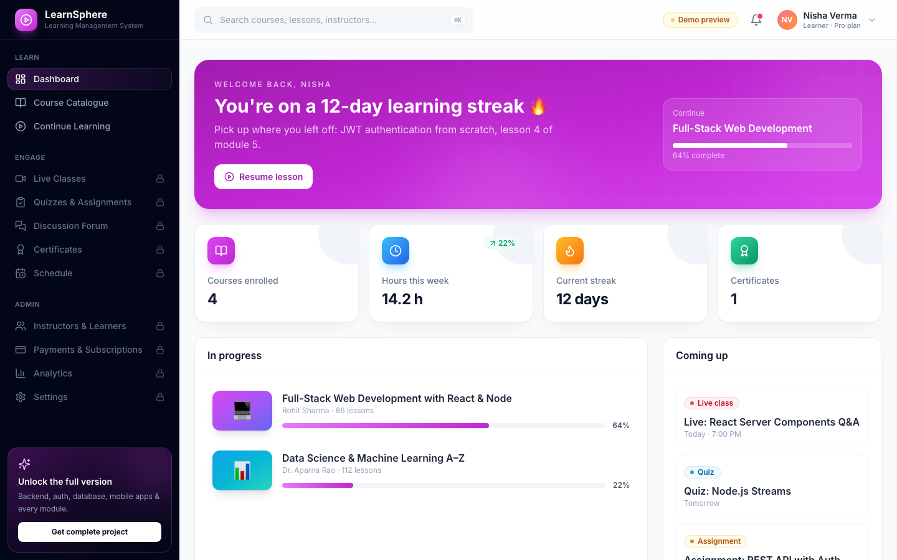
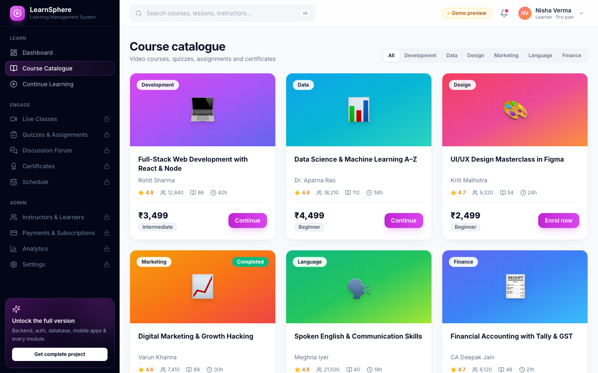
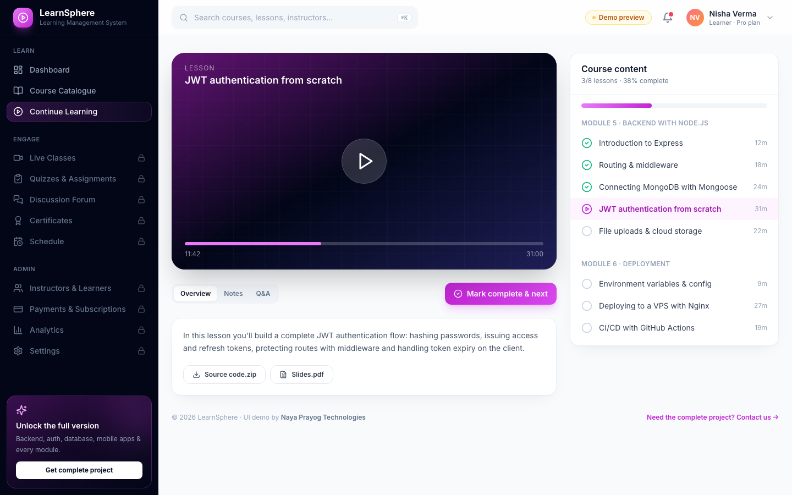

# Learning Management System (LMS) Development

Build a powerful and scalable **Learning Management System (LMS)** with Naya Prayog Technologies.

We develop custom LMS platforms that help educational institutions, universities, coaching centres, training companies, and businesses deliver, manage, and monitor online learning programs.

From online course creation and student enrollment to video lessons, assessments, progress tracking, and certification, we build learning management solutions tailored to your educational and training requirements.

Whether you want to launch an online learning platform, digitize classroom education, or create a corporate training portal, we can help you develop a customized LMS solution.

**Website:** https://nayaprayog.com/

---

<!-- screenshots -->
## Screenshots

**Dashboard**

<table>
  <tr>
    <td align="center" width="50%"><b>Courses</b>  </td>
    <td align="center" width="50%"><b>Learn</b>  </td>
  </tr>
</table>

---

## What Is a Learning Management System?

A Learning Management System (LMS) is a software platform used to create, organize, deliver, and manage educational courses and training programs.

It provides a centralized environment where administrators, instructors, and learners can interact with learning content and monitor educational progress.

A custom LMS can include:

- Online course creation and management
- Student and learner registration
- Instructor and teacher management
- Video-based learning
- Study materials and downloadable resources
- Online examinations and assessments
- Assignment submission and evaluation
- Student progress tracking
- Certificates and completion records
- Learning analytics and reports
- Administration dashboards

## Who Needs an LMS Platform?

We develop learning management solutions for:

- Schools and educational institutions
- Colleges and universities
- Coaching centres and academies
- Online education startups
- Professional training institutes
- Corporate training departments
- Skill development organizations
- Certification and examination providers
- Tutors and independent educators
- E-learning businesses
- Government and vocational training programs

## Key Features & Capabilities

The following features can be developed according to your learning model, audience, and agreed project scope.

### 1. Student & Learner Management

Manage learners and their educational activities through a centralized system.

- Student registration and login
- Learner profiles
- Student enrollment
- Course allocation
- Batch and group management
- Student dashboards
- Learning history
- Attendance tracking
- Progress monitoring
- Student status management

### 2. Course Management

Create and organize structured online learning programs.

- Create and manage courses
- Course categories and subjects
- Course descriptions and objectives
- Modules and chapters
- Lessons and learning materials
- Course prerequisites
- Course duration and schedules
- Course enrollment management
- Free and paid courses
- Course publishing and access controls

### 3. Video-Based Online Learning

Deliver educational content through an online learning environment.

- Recorded video lessons
- Video-based course modules
- Embedded video content
- Lesson-wise video organization
- Learning resource attachments
- PDF and document materials
- Lesson completion tracking
- Resume learning functionality
- Video access permissions

Live classes and interactive streaming can also be integrated using suitable third-party services when required.

### 4. Instructor & Teacher Management

Allow instructors to manage their courses and learning activities.

- Instructor registration and profiles
- Instructor assignment
- Course creation and management
- Lesson and material uploads
- Student enrollment visibility
- Assignment management
- Assessment management
- Student performance monitoring
- Instructor dashboards

### 5. Online Exams & Assessments

Evaluate learner knowledge through structured assessments.

- Multiple-choice questions (MCQs)
- True or false questions
- Short-answer questions
- Long-answer questions
- Topic-wise quizzes
- Chapter-wise tests
- Timed examinations
- Automatic objective-question evaluation
- Manual answer evaluation
- Result generation
- Performance analysis

### 6. Assignment & Homework Management

Support practical learning and instructor-led evaluation.

- Assignment creation
- Assignment instructions
- File and document submissions
- Submission deadlines
- Instructor feedback
- Marks and grading
- Assignment status tracking
- Student submission history

### 7. Learning Progress & Performance Tracking

Help students and administrators understand learning progress.

- Course completion tracking
- Lesson completion status
- Learning activity history
- Quiz and examination results
- Assignment performance
- Student progress reports
- Course completion records
- Learning analytics
- Instructor performance reports

### 8. Certificates & Achievements

Recognize student achievements and completed training programs.

- Course completion certificates
- Certificate templates
- Student certificate records
- Certificate generation
- Certificate download
- Certificate identification numbers
- Certificate verification workflows, where required
- Achievement tracking

### 9. Admin Dashboard

Manage the complete learning platform from a centralized administration panel.

Potential administration capabilities include:

- Platform overview and analytics
- Student management
- Instructor management
- Course and category management
- Batch and enrollment management
- Learning material management
- Examination management
- Assignment monitoring
- Certificate management
- Payment and subscription records
- Notification management
- Reports and analytics
- Admin roles and permissions

### 10. Online Payments & Course Monetization

Support different business models for selling educational content and training programs.

- Paid course enrollment
- Course-wise pricing
- Subscription-based access
- One-time course purchases
- Payment gateway integration
- Payment transaction records
- Enrollment confirmation
- Coupon and discount management
- Payment status tracking
- Invoice and payment history

### 11. Notifications & Communication

Keep learners and instructors informed about important learning activities.

- Course enrollment notifications
- New lesson announcements
- Assignment reminders
- Examination notifications
- Result announcements
- Email notifications
- SMS integration
- WhatsApp integration
- Push notifications
- In-platform announcements

## Types of LMS Platforms We Develop

| LMS Solution | Business Application |
|---|---|
| School LMS | Digital learning for schools |
| College LMS | Course and student learning management |
| University LMS | Academic courses and online education |
| Coaching Institute LMS | Online classes, tests, and study materials |
| Corporate LMS | Employee training and development |
| Online Course Platform | Sell and deliver digital courses |
| Training Management LMS | Manage professional training programs |
| Certification LMS | Deliver courses and certification programs |
| Custom E-learning Platform | Industry-specific learning solutions |

## LMS Development for Web & Mobile

We can develop learning management platforms across different devices and user environments.

**Web Platform**
- Student learning portal
- Instructor dashboard
- Administration dashboard
- Course management system

**Mobile Applications**
- Android learning application
- iOS learning application
- Mobile-friendly course access
- Learning progress and notifications
- Online assessments and learning activities

The required platforms can be developed together or introduced in phases.

## Why Choose Naya Prayog Technologies?

Naya Prayog Technologies develops custom software, web applications, mobile applications, and business automation solutions.

Our education technology experience includes platforms and workflows for managing students, learning resources, educational administration, and digital services.

We focus on:

- Custom LMS development
- Business-specific learning workflows
- Student and instructor dashboards
- Responsive web applications
- Android and iOS application development
- Video and third-party service integrations
- Online payment integration
- Scalable backend architecture
- Education workflow automation
- Deployment and technical support

We build solutions around your educational model instead of restricting your institution to a fixed learning platform.

## Technology & Development

The technology stack can be selected according to project requirements.

- Frontend: React.js, Next.js, HTML, CSS, JavaScript
- Backend: Node.js, Express.js, Python, Django
- Database: MySQL, PostgreSQL, MongoDB
- Mobile Applications: Flutter
- Integrations: Video services, payment gateways, email, SMS, and notification APIs
- Deployment: Cloud hosting and VPS environments

The final architecture depends on expected learners, course content, concurrent usage, integrations, and scalability requirements.

## Our LMS Development Process

1. **Requirement Analysis** – Understand your institution, learners, courses, and teaching model.
2. **Platform Planning** – Define student, instructor, administrator, and learning workflows.
3. **UI/UX Design** – Design an intuitive learning experience across devices.
4. **Development** – Build the LMS frontend, backend, dashboards, and required modules.
5. **Integration** – Configure video services, payments, notifications, and external APIs.
6. **Testing** – Test enrollment, lessons, assessments, progress tracking, and administration.
7. **Deployment** – Deploy the LMS to your selected hosting environment.
8. **Future Expansion** – Extend the platform as your educational requirements grow.

## Frequently Asked Questions

### What is LMS software?

LMS software is a platform used to create, deliver, manage, and track online courses, educational programs, and employee training.

### Can you develop a custom LMS for my institute?

Yes. We can develop a custom learning management system for coaching institutes, schools, colleges, universities, and training organizations.

### Can students watch recorded video lectures?

Yes. Video-based lessons and organized course modules can be incorporated into the platform using suitable video hosting or streaming services.

### Can I conduct online tests and examinations?

Yes. Online quizzes, MCQ examinations, timed tests, and other assessment workflows can be developed according to your requirements.

### Can instructors upload courses and study materials?

Yes. Instructor dashboards can be developed to manage courses, lessons, videos, documents, and learning resources.

### Can students receive certificates after completing courses?

Yes. Certificate generation and verification workflows can be developed based on your institution's requirements.

### Can you develop an LMS mobile application?

Yes. Android and iOS learning applications can be developed alongside the web-based LMS.

### Can I sell online courses through the LMS?

Yes. Paid courses, subscriptions, payment gateway integration, and enrollment management can be included.

### How much does custom LMS development cost?

The cost depends on the number of modules, user roles, video delivery requirements, mobile applications, integrations, and overall platform complexity. Contact our team for a project-specific estimate.

## Build Your Custom Learning Management System

Planning to launch an online education platform, digitize your institute, or create a corporate learning portal?

Naya Prayog Technologies can help you transform your educational requirements into a customized digital learning platform.

**Naya Prayog Technologies**

- Website: https://nayaprayog.com/
- Email: [support@nayaprayog.com](mailto:support@nayaprayog.com)
- Phone / WhatsApp: +91 7991327022
- WhatsApp: https://wa.me/917991327022
- Portfolio: https://github.helloharendra.io

**Contact us to discuss your Learning Management System development project.**

---

## Repository Information

This repository serves as a service and project showcase for Learning Management System (LMS) development by Naya Prayog Technologies.

It does not grant permission to redistribute, resell, or commercially reuse proprietary company materials or software. Project-specific source code, deliverables, and licensing terms are agreed separately.
